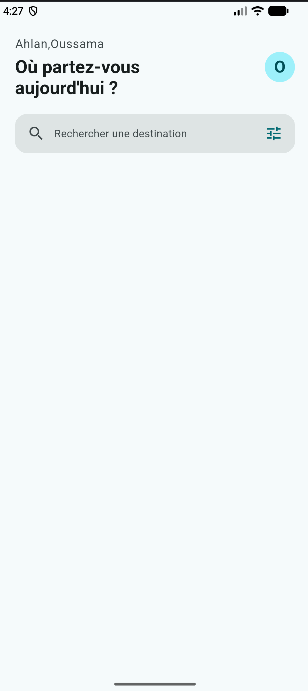
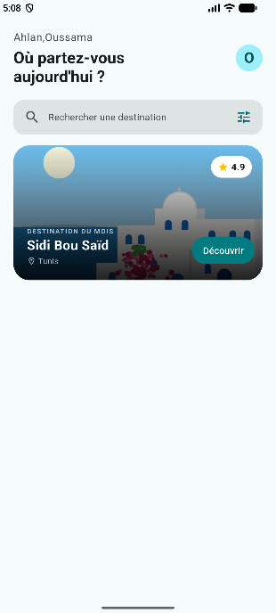

# rihla

A new Flutter project.

## Getting Started

This project is a starting point for a Flutter application.

A few resources to get you started if this is your first Flutter project:

- [Learn Flutter](https://docs.flutter.dev/get-started/learn-flutter)
- [Write your first Flutter app](https://docs.flutter.dev/get-started/codelab)
- [Flutter learning resources](https://docs.flutter.dev/reference/learning-resources)

For help getting started with Flutter development, view the
[online documentation](https://docs.flutter.dev/), which offers tutorials,
samples, guidance on mobile development, and a full API reference.

Palier 1 :

Palier 2 :

Q1/
column prend largeur nécessaire a son contenu, si les textes sont trop longs, ub debordement horizontal se fait apparaitre

Q2/
StatelessWidget permet d'afficher les données qui ne doit pas modifier c'est pour cela le prenom est final

Q3/
cs.primary utilise lla couleur principal du theme  
Colors.teal est un coleur predefinie et ne change pas automatiquement quand seedColor change.

Palier 3 :

Q1/ 
Le degradée dessiné derriere l'image ,le texte blanc sera difficile à lire.

Q2/
les coins de la banniere ne sont plus découpé par le widget donc l'image peut depasser les coins.

Q3/
Pour preserver la place au boutton decouvrir.