# rihla

A new Flutter project.

## Getting Started

This project is a starting point for a Flutter application.

A few resources to get you started if this is your first Flutter project:

- [Learn Flutter](https://docs.flutter.dev/get-started/learn-flutter)
- [Write your first Flutter app](https://docs.flutter.dev/get-started/codelab)
- [Flutter learning resources](https://docs.flutter.dev/reference/learning-resources)

For help getting started with Flutter development, view the
[online documentation](https://docs.flutter.dev/), which offers tutorials,
samples, guidance on mobile development, and a full API reference.

Palier 1 :

Palier 2 :
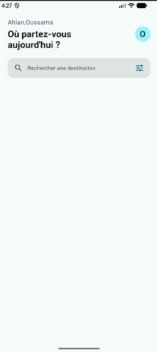

Q1/
column prend largeur nécessaire a son contenu, si les textes sont trop longs, ub debordement horizontal se fait apparaitre

Q2/
StatelessWidget permet d'afficher les données qui ne doit pas modifier c'est pour cela le prenom est final

Q3/
cs.primary utilise lla couleur principal du theme  
Colors.teal est un coleur predefinie et ne change pas automatiquement quand seedColor change.

Palier 3 :

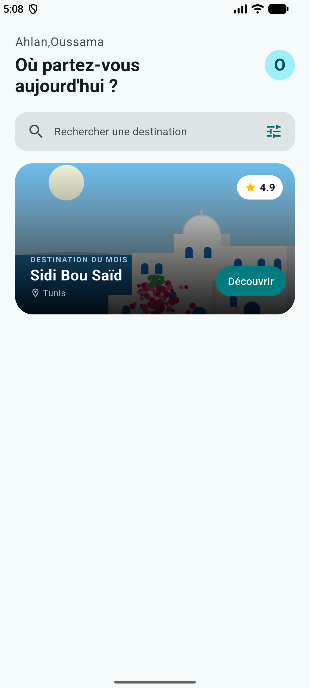

Q1/ 
Le degradée dessiné derriere l'image ,le texte blanc sera difficile à lire.

Q2/
les coins de la banniere ne sont plus découpé par le widget donc l'image peut depasser les coins.

Q3/
Pour preserver la place au boutton decouvrir.

Palier 4 :

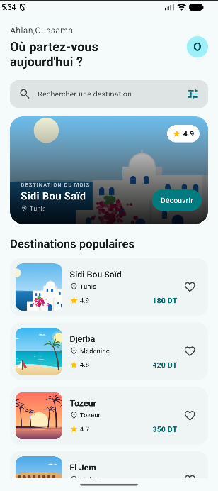

Q1/
le spacer peut manquer d'espace fini et provoque un probelm de mise en page .Quoique le Row donne une largeur a la Column grace a Expand.
Q2/ 
Il suffit de ajouter une destination dans lib/data/destinations.dart et le boucle affichera auto .

Palier 5 :

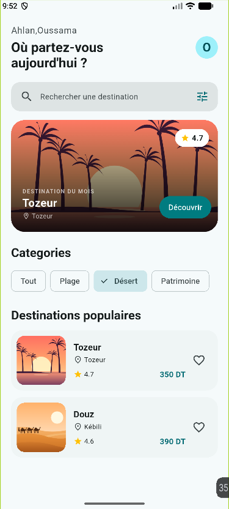

Q9/

sans setState la valuer _categorie change en memoire mais flutter n'est pas eu du changement, les cartes restent inchangés.

Q10/

pour afficher les destinations correspondent a la categorie selectionnee 

Q11/

car il n'a pas besoin de faire un etat interne.

Palier 6 :

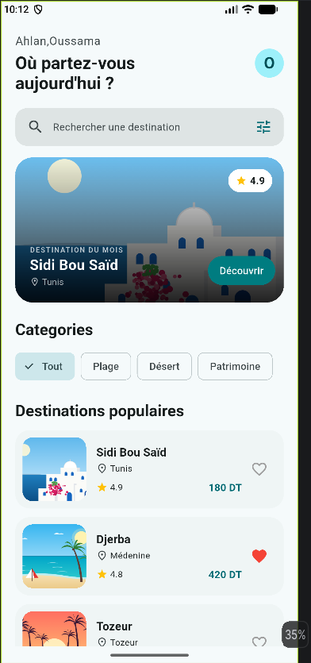

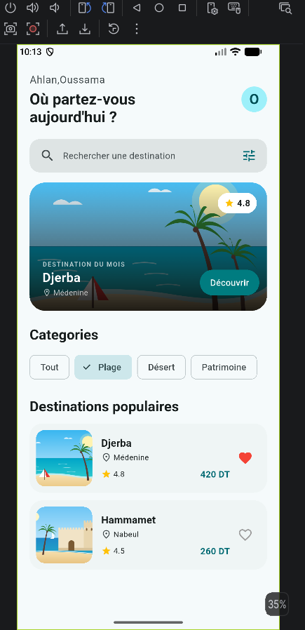

Palier 7 :

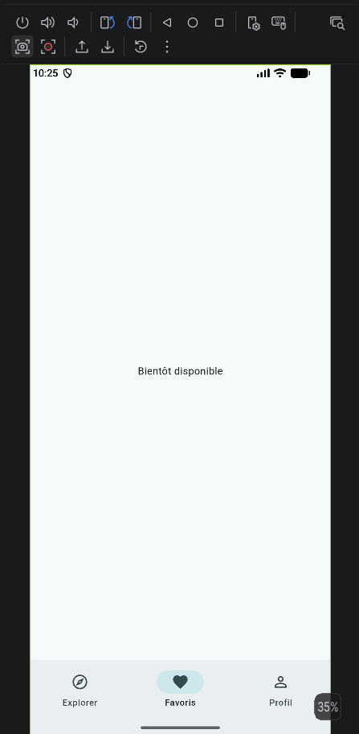

Le Devoir :

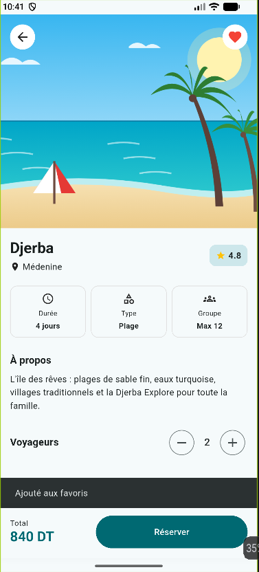

Palier 1 du TP5:
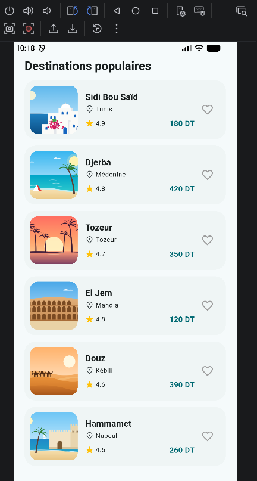

Palier 2 du TP5:
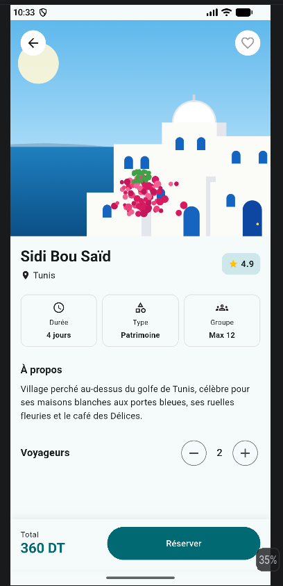

Q1/filtre est conserve car HomeScreen reste dans la pile de navigation et DetailScreen est ajouté au dessus.  .pop retire DetailScreen et rtrouve HomeScreen

Q2/DetailScreen recoit la destination dans constructor. on utilise  le passage du parametre

Q3/ sans le ClipBehavior leffet d'encre depasse les coins de la carte

Palier 3 du TP5:

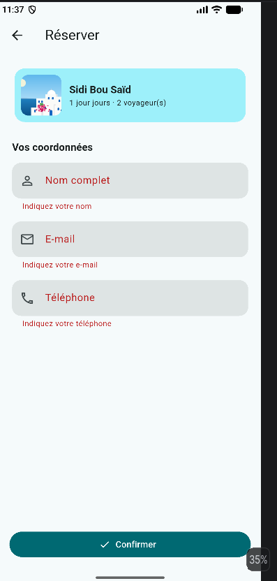

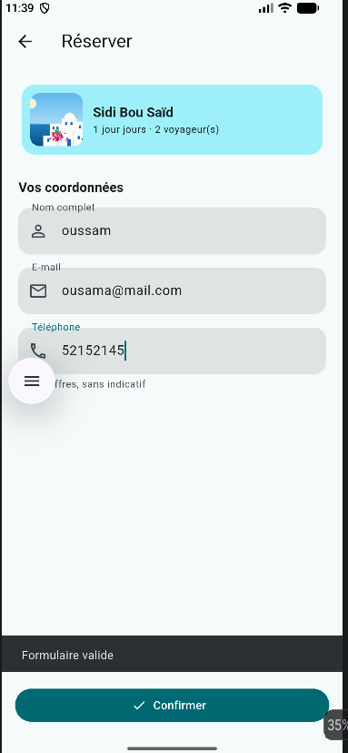

Q1/

vérifie tous les champs du formulaire ,elle renvoie true si tout est correct, et false si au moins un champ a une erreur.

Q2/

inputFormatters bloque les mauvais caractères pendant la frappe ,validator verifie la valeur finale et affiche un message d'erreur.

Q3/

 Pour liberer la memoire quand l'ecran est fermé et éviter une fuite de mémoir

Palier 4 du TP5

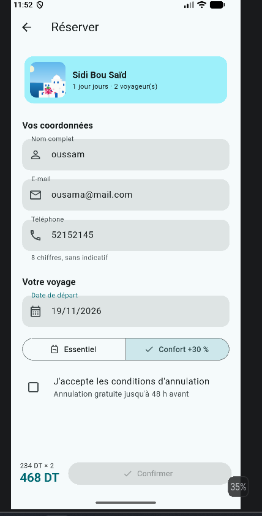

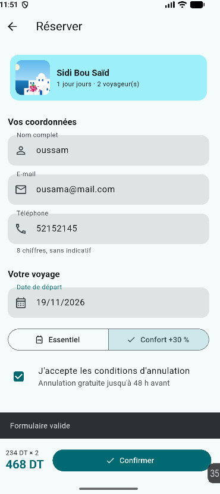

Q1/Pour user choisis la date avec calendrie pas le clavier

Q2/ getter recalcule la valeur a chaque appel quand setState() reconstruit l'ecran, _total est relu avec la nouvelle formule.

Palier 5 du TP5

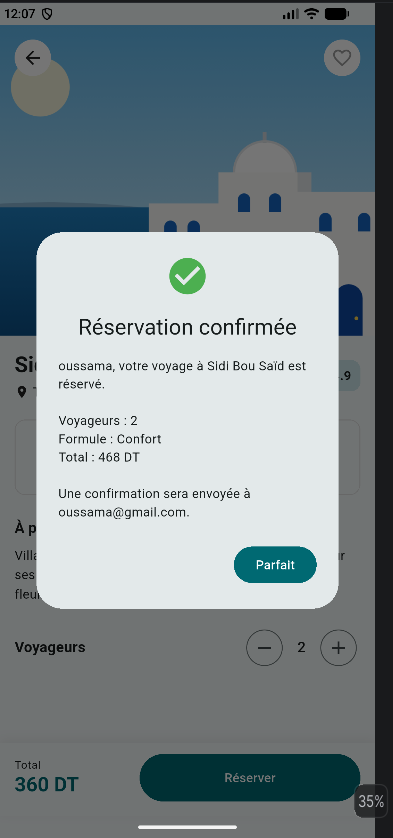

Q1/

null car aucune valeur n'a été renvoyée avec pop

Q2/
"Don't use 'BuildContext's across async gaps"

apres l await lecran a peut etre fermé et utiliser son context peut causer des erreurs

Q3/
 boîte de dialogue est un ecran posé sur la pile de navigation, comme une page. On la ferme donc avec pop.

Palier 6 du TP5 :

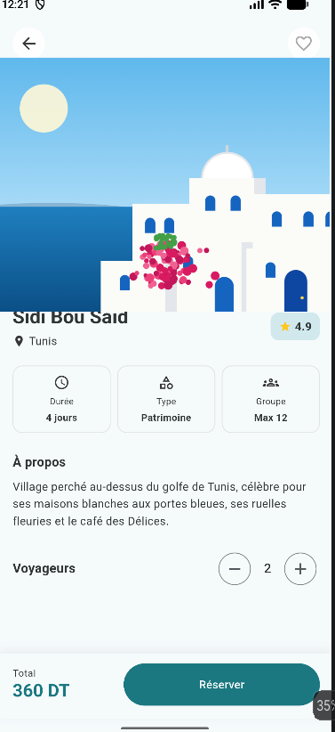

Checkpoint 1:

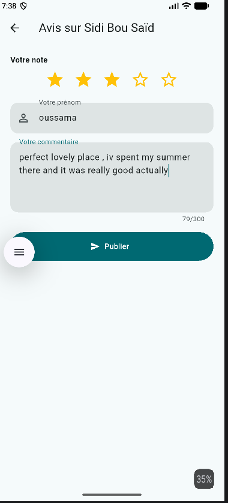

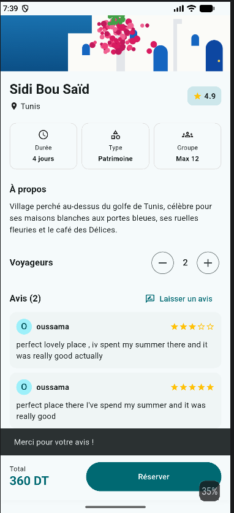

##TP5 Consomations API

 Palier 0 :

 Q1/

 404 se sont les familles 4.x.x

 Q2/

Le serveur choisi lid de la reservation creee

Q3/

GET sert a lire seulement contrairement au POST doir envoyer des donnes a creer donc on a besoin du body

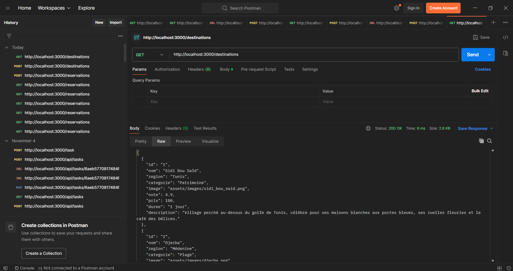

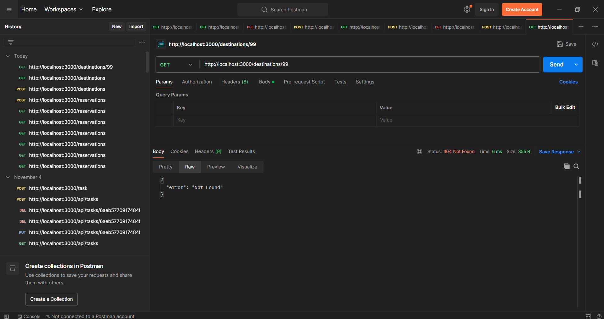

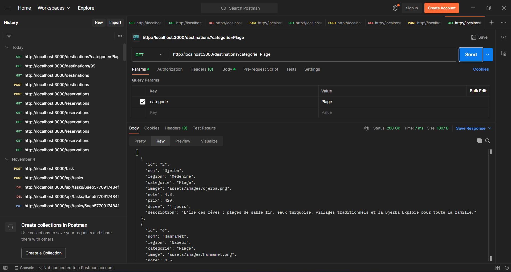

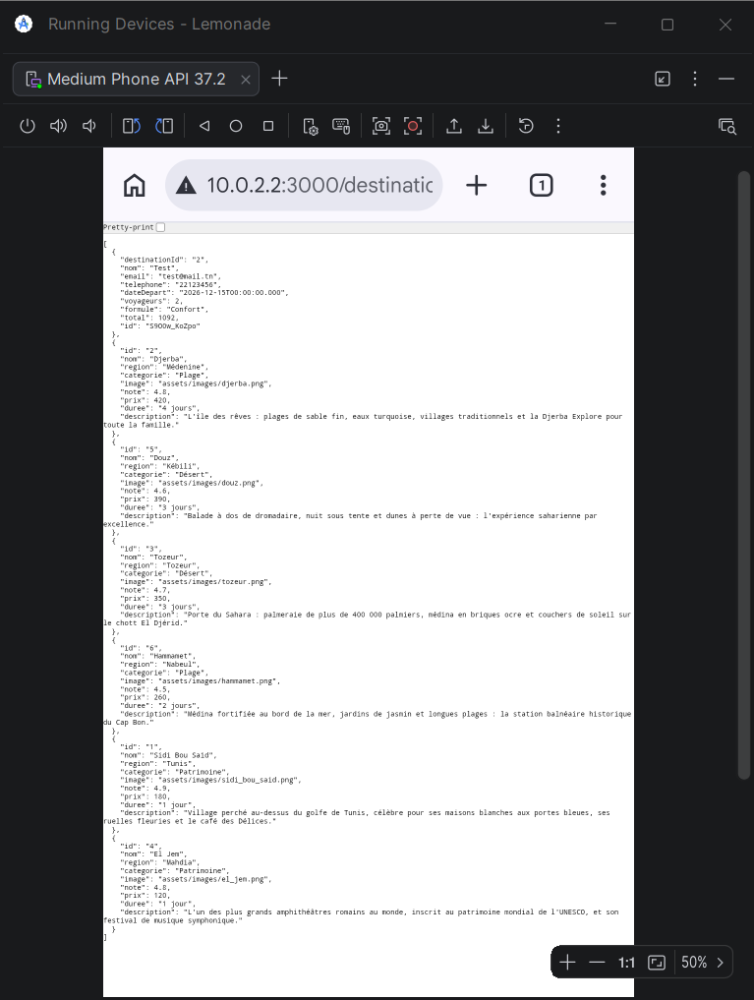

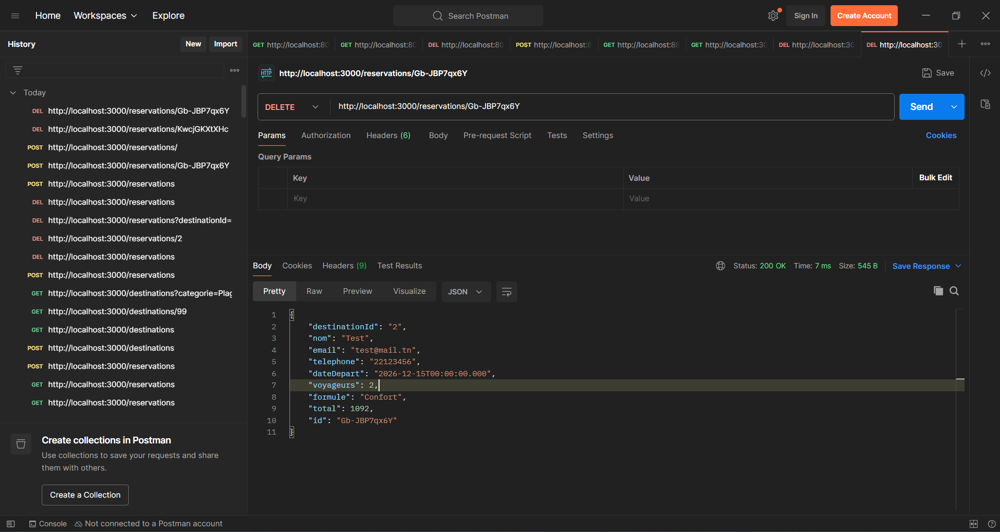

Palier 1 :

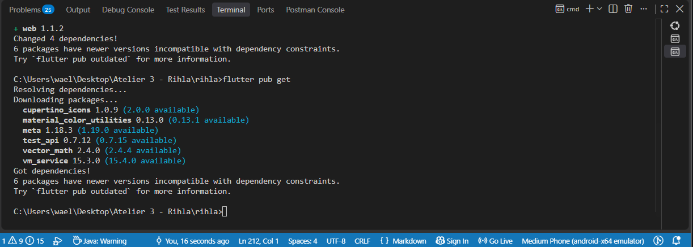